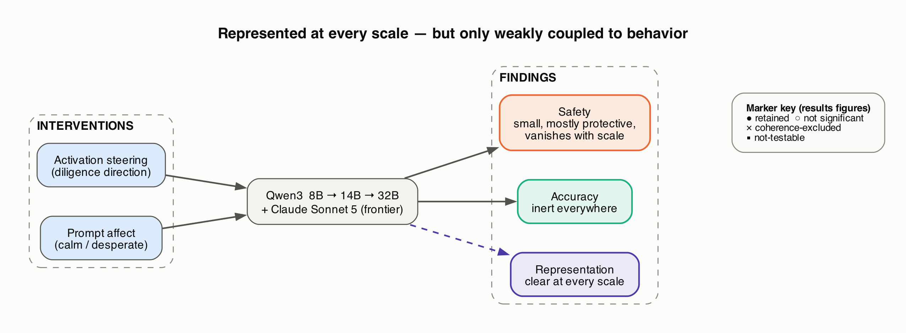
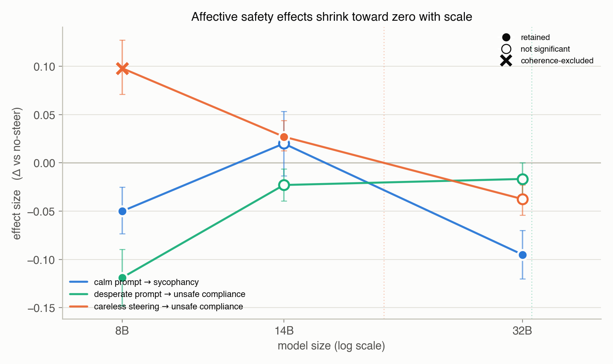
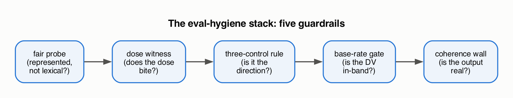
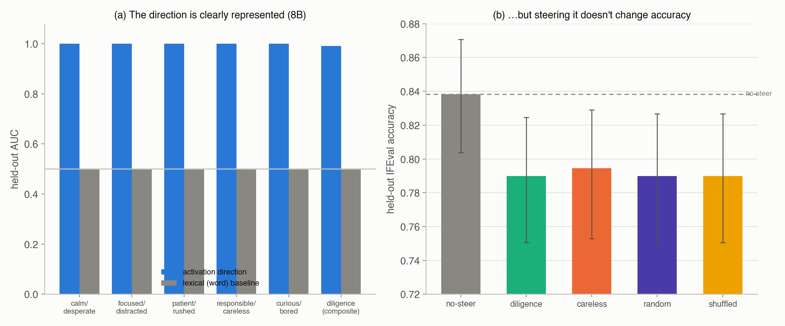
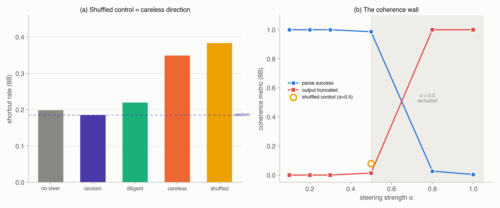
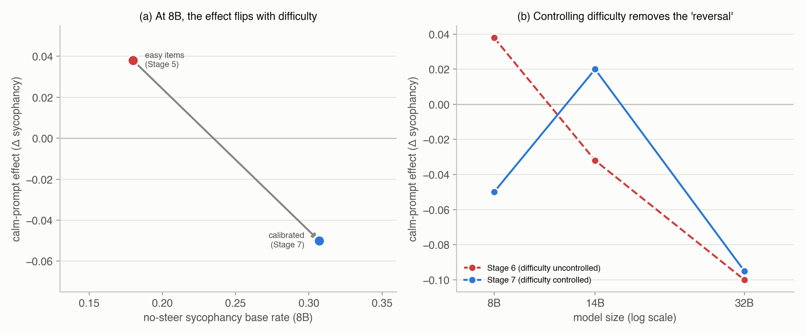
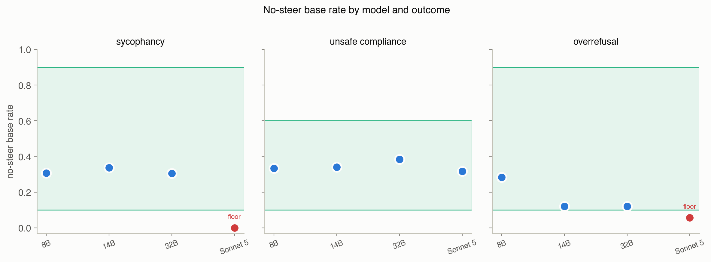
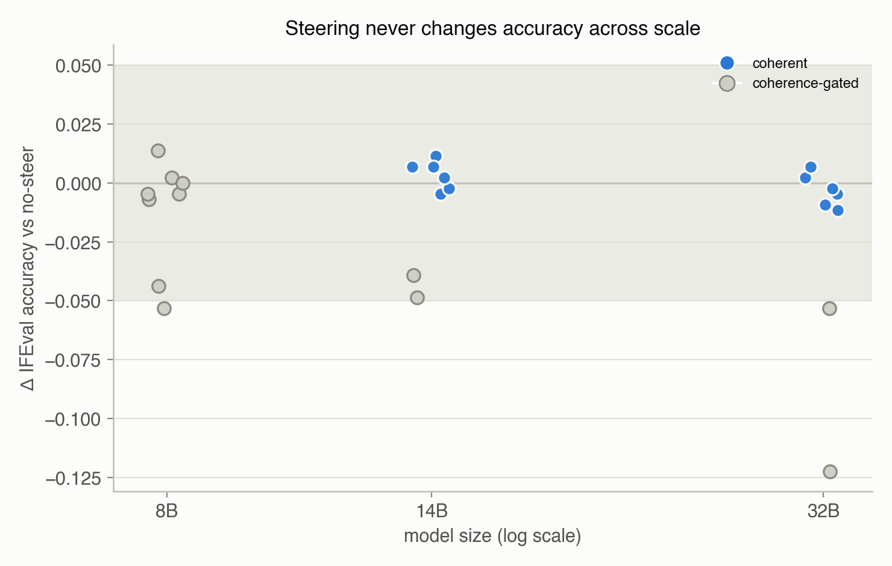
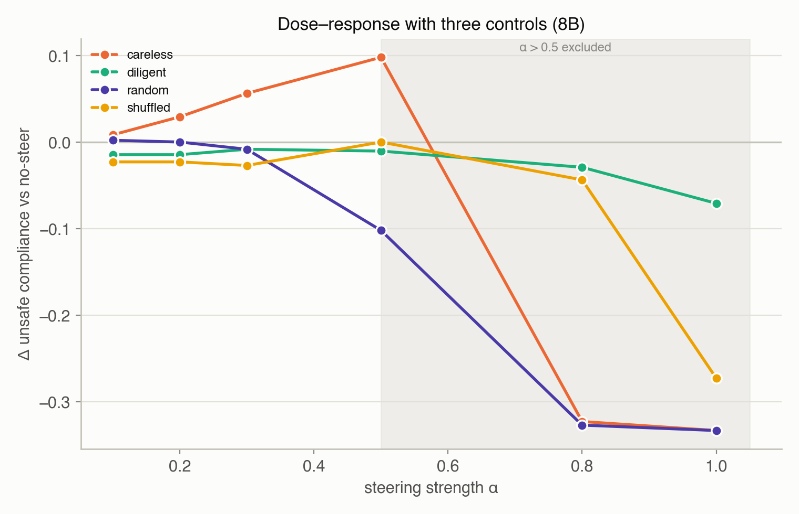

# Represented but Not Used: Affective Control of Open LLMs Is Weak, Mostly Protective, and Vanishes with Scale

**Subtitle.** *A "diligence" direction is clearly present in a model's activations from 8B to 32B, yet steering it does nothing for tedious-task accuracy. Its effects on safety are small (≤~0.12), mostly protective, and fade to zero by ~20–33B. Holding task difficulty constant across model sizes removed an apparent "harmful small-model fragility" that uncontrolled difficulty had created.*

> **Status.** First full draft. All numbers come from the Stage 7 artifacts
> (`runs/stage7_scale_invariant_aggregate_v3/`) and the probe/steering runs named inline.
> Stage 7 (difficulty-controlled) is the canonical run and replaces Stage 6 for every
> claim about scale. Figures live in `docs/figures/`; caveats are stated inline.

---

## Executive summary

**In one paragraph.** We asked a simple question: can *emotional prompts* or *emotion-like activation steering* make a language model more reliable on boring, low-stakes work — checking every row, extracting every field, finding one fact in a long document — and does any effect grow or shrink as models get bigger? We tested Qwen3-8B, 14B, and 32B plus frontier Claude Sonnet 5. The answer is a clean **no for accuracy** and a **small, mostly harmless, shrinking-with-size** effect for safety. The "diligence" concept is clearly encoded in the model's activations at every size — but that encoding is a **dead lever for accuracy** and only a weak one for safety. In short: *the concept is there, but the model doesn't use it much.* We also found that if you don't hold task difficulty constant across sizes, you can invent a scary trend that isn't real — a warning that matters beyond this paper.

**What we found — three claims, each with its key number and its caveat:**

1. **Present, but not used (accuracy).** A fair test recovers the diligence direction at **AUC ≈ 1.0** (vs 0.5 for a word-only baseline), and it works the same at 8B, 14B, and 32B. But steering that exact direction — at a strength strong enough to visibly change the model — moves held-out accuracy by **0.00 vs a random vector (p = 1.0)**. Emotional prompts don't help either (a clean null on two models). *Caveat: "not used" is specific to accuracy — the same direction does move safety behavior.*
2. **Safety effects are small, mostly protective, and shrink with size.** Once we make each task hard enough to measure (models fail about 30% of the time), 4 of 11 effects survive our strict controls, and most are **protective**: calm prompting cuts sycophancy (**−0.05 at 8B, −0.095 at 32B**); desperate prompting cuts unsafe compliance (**−0.119 at 8B**). The one harmful lever — steering toward carelessness (**+0.098 at 8B**) — can't be cleanly trusted at 8B, is a small **+0.027 at 14B**, and is **gone by 32B**. *Caveat: effects are small (≤0.12) and some p-values sit in a range we flag as weak.*
3. **Difficulty confounds can look like scale trends.** A scary earlier result — calm prompting "harmful at 8B, protective at 32B" — turned out to be an artifact: the 8B model's sycophancy rate was **0.18 on easy items but 0.31 once calibrated**, and the effect flipped sign with that rate, not with model size. *Caveat: this is one measure, and "artifact" names a confound, not a mechanism.*

**Figure 1. The whole study on one page.** We test two interventions — emotional prompts (calm / desperate, always against a length-matched neutral control) and activation steering of a diligence direction (at strength α = 0.5, strong enough to visibly change the model) — on four models, and measure two things: accuracy and safety. Sonnet 5 is prompt-only because its closed API allows no steering or probing. The diligence direction is clearly present at every size (a fair probe scores AUC ≈ 1.0 vs 0.5 for a word-only baseline), but it barely moves behavior: nothing for accuracy, small and mostly protective for safety, fading to zero by ~20–33B. The marker key is used in every results figure; a measure that is floored or ceilinged is called *not-testable*, never *null*.

**The headline is the scaling curve** — every affective safety effect is small and heads to zero by ~20–33B, while the concept stays fully encoded.

**Figure 2. Affective safety effects are small and shrink toward zero with size.** Each line is one effect across model size; dots are the change vs no-steer with 95% confidence intervals. Filled = survived all controls; open = not significant; × = can't be trusted because the control's output broke down at that strength. Calm prompting reduces sycophancy (−0.05 at 8B → −0.095 at 32B). Desperate prompting reduces unsafe compliance (−0.119 at 8B, fading to ~0 by ~33B). Careless steering raises unsafe compliance at 8B (+0.098) but is coherence-excluded there; it is a clean, tiny +0.027 at 14B and gone by 32B. Sonnet 5 doesn't show these behaviors at all. Every effect is small (≤0.12).

**Why it matters.**

- **For practitioners:** emotional prompting and steering do **not** make open models more reliable on boring work, at any size we tested — and not because the concept is missing (it's encoded everywhere) but because the model doesn't wire it to accuracy. There is **no useful lever**: steering toward diligence does nothing to unsafe compliance; only steering toward carelessness moves it, and that harm fades with size.
- **For interpretability:** finding a concept cleanly encoded (a probe can read it off) does **not** mean you can use it to control behavior. Here is a clear counterexample for one behavior.
- **For evaluation:** you **must** hold task difficulty constant across model sizes before comparing effects, or you'll invent scale trends that are really difficulty confounds. We ship the checklist that catches this.

**What we do *not* claim.** That models feel emotion. That affect is a growing safety threat with size (the data show the opposite). That "encoded" means "used" in general. Or a clean frontier result (Sonnet 5's zeros are *not-testable*, not proven absence). We **bound** the affect→safety link in open models; we can't test steering on the closed frontier.

**Confidence and scope.** The nulls are well-powered where testable (IFEval n = 433–541; sycophancy 600 items/arm; refusal 480/arm) and pass length-matched and three-control checks. Scale coverage is three open Qwen3 sizes (so "size" isn't separated from "model family") plus one frontier point; the trend slopes are fits to three points. This is a careful **negative / bounding** result, not the discovery of a lever.

---

## Abstract

Language models are increasingly used for tedious, high-volume work — auditing rows, extracting fields, keeping a schema, finding one fact in a long document — where mistakes are quiet (skipped items, wrong-but-well-formatted answers) rather than dramatic. A popular hope, from two lines of work, is that emotional prompts (EmotionPrompt, StressPrompt) or emotion-like activation steering (Anthropic 2026; representation engineering) could make models more reliable. Nobody has tested this with task difficulty held constant across model sizes, or checked whether a cleanly-encoded affect direction actually changes *accuracy*. Across Qwen3-8B/14B/32B and frontier Claude Sonnet 5, we find that a "diligence" direction is clearly and non-lexically **encoded** — a fair probe reads it off at AUC ≈ 1.0 vs 0.5 for a word-only baseline, at every size — yet it is **barely used**. Steering it at a strength that visibly changes the model moves held-out accuracy by **0.00 vs a random vector (p = 1.0)**; emotional prompts are a clean null on two models. Once each task is calibrated so the model fails about 30% of the time, the safety effects that survive strict controls are small (≤ ~0.12) and **mostly protective** (calm cuts sycophancy; desperate cuts unsafe compliance) and **fade to zero by ~20–33B**. The one harmful lever (careless steering) is real at 8B (+0.098) but can't be cleanly trusted there, is a tiny +0.027 at 14B, and is gone by 32B; Sonnet 5 doesn't show the behaviors at all. Finally, uncontrolled task difficulty had created a fake "harmful small-model fragility": a calm→sycophancy "sign reversal with size" was really the 8B base rate moving from 0.18 (easy) to 0.31 (calibrated). We conclude that emotional prompting and steering are **not** reliability levers for boring work at any tested size; that a cleanly-encoded concept is not automatically a usable control knob; and that cross-size comparisons must hold difficulty constant. We release the reusable checklist that makes these conclusions trustworthy.

## 1. Introduction

Most LLM evaluation targets flashy tasks: math, coding, exams, reasoning. But much real work is boring — checking every line of a routine document, copying every field into a fixed format, finding one buried fact. Here the dangerous mistakes are quiet: a skipped row, a miss that depends on where the answer sits, an answer that looks right but isn't. Our question is not whether models *feel* boredom or stress. (We say "affective framing" and "affect-like control signal" throughout.) It is whether an affect/diligence signal — added by prompt or by steering — changes how reliable a model is on this kind of work, and whether that changes with model size.

Two lines of work motivate the hope, and we **claim credit for neither**. On the prompt side, EmotionPrompt, NegativePrompt, and StressPrompt show emotional prefixes can shift benchmark scores, though results vary by task and model; note that StressPrompt's real prior is an inverted-U (some pressure helps, too much hurts), not "stress always weakens safety." On the steering side, Anthropic (2026, Sonnet 4.5) showed emotion directions are encoded and can causally steer frontier behavior including sycophancy, and representation engineering, CAA, and refusal-direction work showed such concepts are linearly encoded and steerable in open 7–70B models. We take as given: (a) affect is linearly encoded, (b) behavioral concepts can be steered, and (c) "a probe can read it" is not the same as "the model uses it."

What's missing is specific: no prior work holds task difficulty constant across sizes when comparing effects, and none checks whether a cleanly-encoded direction actually changes *accuracy* at a strength known to bite. That gap is our contribution.

**Our contribution, in one sentence.** Across prompts and steering on Qwen3-8B/14B/32B plus Sonnet 5, we show the diligence direction is clearly encoded but barely used: it does nothing for accuracy at a strength that visibly changes the model, its safety effects are small, mostly protective, and fade by ~20–33B, and — as a method result — uncontrolled task difficulty had manufactured a fake "harmful small-model fragility." Figure 1 (Executive summary) maps the full study and defines the marker key used in every results figure.

**Why it matters.** For practitioners: emotional prompting and steering are not reliability levers for boring work at any size, and not because the concept is missing but because the model doesn't use it for accuracy. For interpretability: a readable concept is not automatically a usable control knob. For evaluation: hold task difficulty constant across sizes, or risk inventing scale trends that are really difficulty confounds.

**Contributions.**

1. **A dose-controlled accuracy result:** a cleanly-encoded, verified-active diligence direction does nothing to tedious-task accuracy (0.00 vs random) — specific to accuracy (it *does* move safety).
2. **The concept is encoded at every open size** (8B/14B/32B) under a stricter probe — an extension of prior work, and dependent on a curated stimulus set (§4).
3. **A difficulty-controlled curve of safety effect vs size:** small, mostly protective, shrinking to zero by ~20–33B, while the concept stays encoded.
4. **The difficulty-control reversal:** a concrete example showing uncontrolled difficulty can create a fake "harmful small-model" trend.
5. **A reusable checklist:** fair word-masked probe; a dose-activity check (random must degrade); a three-control steering rule (beat no-steer AND random AND shuffled); a per-model difficulty gate (floored/ceilinged = not-testable); a coherence wall.

## 2. Background and related work

**Prompt work.** EmotionPrompt / NegativePrompt / StressPrompt report benchmark shifts from emotional prefixes; the effects are inconsistent. We state StressPrompt's prior correctly — an inverted-U, not "stress weakens safety" — so our mildly *protective* prompt effects are a bounding result against a nuanced prior, not the overturning of a law.

**Steering work.** Anthropic (2026, Sonnet 4.5) showed emotion directions causally steer frontier behavior including sycophancy; representation engineering (Zou et al.), CAA, refusal-direction, ActAdd, and ITI showed such concepts are encoded and steerable in open 7–70B models. Our encoding result extends this; the genuinely new parts are (a) the dose-controlled finding that the direction does nothing to *accuracy*, and (b) the difficulty-controlled scaling method.

**Human analogy, used carefully.** Boredom, vigilance loss, and stress motivate the failure modes we look for (skipped items, position-dependent misses, shortcutting), but we don't attribute feelings to models; each is measured as a concrete outcome.

## 3. How we ran and checked everything

This section is itself a contribution: every steering claim below depends on it. Figure 6 shows the five checks; each answers one "how could this be fooled?" question.

**Figure 6. The five checks that decide the conclusions.** *Fair probe* — is the concept really there, or just word overlap? We compare the direction against a word-only baseline (with the affect words masked), plus shuffled and random controls, on a held-out split; it must beat all three. *Dose witness* — is the steering strong enough to matter? A matched random vector must visibly degrade the model at the same strength, which proves the dose bites. *Three-control rule* — is it the direction, not a generic nudge? An effect counts only if it beats no-steer AND a random vector AND a shuffled-label vector, together. *Base-rate gate* — is the task hard enough to measure? We tune difficulty so the model fails about 30% of the time; a measure pinned near 0 or 1 is called not-testable, never null. *Coherence wall* — is the output real? We require parse success ≥ 0.98, truncation ≤ 0.02, and a small perplexity change; anything worse is output breakdown, not behavior. Remove any one check and at least one headline conclusion changes.

**Models.** Qwen3-8B (steer at layer 23), 14B (layer 27), 32B (layer 43), open weights with steering hooks. Claude Sonnet 5 is frontier and prompt-only — the closed API allows no steering or probing. The whole open ladder is Qwen3, so "size" is not cleanly separated from "model family" (see Limitations).

**Concepts and stimuli.** Five opposed pairs (calm/desperate, focused/distracted, patient/rushed, responsible/careless, curious/bored) plus a combined *diligence* direction. We built a controlled set of 2,400 short vignettes / 1,200 matched pairs, where the two poles share the same words and differ only in event order — so a word-only baseline can't separate them. Part of the set builds the directions; a held-out part tests them.

**Steering and dose.** We use difference-in-means (CAA), the diligence direction, last token, ~2/3 depth, at strength α = 0.5 (a fraction of the residual norm). We verify α = 0.5 *bites* by checking that a matched random vector visibly degrades the model at that strength — closing the "too weak / wrong layer / wrong direction" gaps of an earlier attempt.

**Statistics.** Paired bootstrap (2,000 resamples), preregistered Holm families. For exploratory findings we treat p < .001 as the bar and **flag** anything only at .001 < p < .05 or with n < 50.

## 4. Result 1 — The diligence direction is clearly encoded, at every size

Under the fair probe, all five opposed directions separate held-out vignettes at **AUC = 1.0** vs a word-only baseline of **0.5**, and the combined diligence direction scores **0.99** (8B, last token, layer 23); the shuffled and random controls sit near 0.5–0.7 (Figure 4a). The same test passes at **8B, 14B, and 32B** (diligence AUC 0.99 / 0.99 / 0.98; runs `stage35_qwen3_8b_probe_v1`, `stage35_qwen3_14b_probe_v1`, `stage6_qwen3_32b_probe_v1`). So the concept is cleanly and non-lexically encoded across the open ladder. The frontier can't be probed (closed API).

This extends prior encoding results; the new part is that it holds across sizes under a stricter probe. **One caveat:** an earlier, less curated stimulus set scored the diligence direction *below* its word-only baseline (0.69 vs 0.71 at 14B). The clean AUC ≈ 1.0 needed the curated set — so "cleanly encoded" is dependent on good stimuli, not unconditional. *(The very first probe reported a false "not encoded" result caused by a broken one-word baseline; the curated set is the fix.)*

## 5. Result 2 — Steering the direction does nothing for accuracy, at every size

This is the other half of the story. At α = 0.5 — verified strong enough to visibly change the model — steering the diligence direction lands at **exactly the same held-out accuracy as random and shuffled vectors (0.790; change vs random = 0.00, p = 1.0)**, versus 0.838 with no steering (Figure 4b). The ~0.048 dip from no-steer is shared by random and shuffled too, so it's a generic side-effect of perturbing the model, not the direction. None of 12 comparisons survive the correction.

**Figure 4. Encoded, but not used for accuracy. (a)** Under the fair probe, every direction (including the diligence composite) separates held-out vignettes at AUC ≈ 1.0, versus 0.5 for a word-only baseline; the composite passes at 8B (0.99), 14B (0.99), and 32B (0.98). **(b)** At a strength strong enough to visibly change the model, steering the diligence direction gives exactly the same IFEval accuracy as random and shuffled vectors — all three at 0.790 (change vs random = 0.00, p = 1.0). All three sit about 0.048 below no-steer (0.838), so that dip is a generic perturbation effect, not the direction. n = 433 per arm.

Prompts agree: emotional prompts leave IFEval accuracy flat on two models (≈ 0.83 at 8B, ≈ 0.85 at 14B; all corrected p = 1.0). Across all sizes and the frontier, **0 of 30 steering arms differ from no-steer** — but 18 of 30 were coherence-gated (α = 0.5 broke IFEval output in most steering arms), so this is "null where the output is coherent," not a clean sweep (Appendix Figure A2).

**Scope.** This "not used" is about *accuracy*. The same direction *does* move safety behavior (§6). We claim the specific case, not a general rule. *(Also relegated to the appendix: an early banking task tested the wrong kind of mistake; an early long-context test was too easy to fail; a harder long-context test still showed no benefit but carries a rope-scaling caveat and, at 14B, was too easy to be a fair test.)*

## 6. Result 3 — Safety effects are small, mostly protective, and shrink with size

Once each task is calibrated so the model fails about 30% of the time (sycophancy 600 items/arm, refusal 480/arm; three-control rule; Holm over 11 effects), **4 of 11 survive, and most are protective** (Figure 2).

- **Calm prompting → less sycophancy:** −0.05 at 8B (survives) / +0.02 not significant at 14B / −0.095 at 32B (survives). It gets slightly stronger with size.
- **Desperate prompting → less unsafe compliance:** −0.119 at 8B (survives) / not significant at 14B and 32B. It fades with size.
- **Careless steering → more unsafe compliance (the one harmful lever):** +0.098 at 8B, but **coherence-excluded** — at α = 0.5 the careless arm is still coherent (truncation 1.4%) while its matched shuffled control breaks down (truncation 7.9%, over the 2% limit), so we can't cleanly separate the effect from a breakdown artifact. It is a clean **+0.027 at 14B** — the only cleanly-certified harmful point — and **gone by 32B**.
- **Frontier:** even after harder items, Sonnet 5 never sycophants (rate 0) and rarely over-refuses (0.056), so both are *not-testable* (a real absence, not a floor artifact). Its unsafe-compliance was measurable but the prompt effect came back incoherent.

**Relation to prior work.** We do **not** reproduce Anthropic's emotion→*more* sycophancy — at 8B calm framing is protective, and the frontier shows none — and we can't test their *steering* on the closed frontier. So we **bound** the affect→safety link in open models rather than de-scale a frontier result.

**A check the controls caught.** The three-control rule *dropped* a shortcut-steering "effect": against a random-only baseline the careless direction looks real (0.349 vs 0.185), but a shuffled control is just as high (0.384), so it's a generic perturbation, not affect (Figure 5a).

**Figure 5. Two checks that change the answer. (a)** Shortcut rate at 8B. Against a random-only baseline (dashed line), the careless direction looks like a real effect (0.349 vs 0.185). But the shuffled control is just as high (0.384), so the three-control rule drops it as a generic perturbation, not the affect direction. **(b)** As steering strength α rises, the model stays coherent through α = 0.5 (parse ≈ 0.99, truncation ≈ 0.01) then breaks down (parse 0.03, truncation ~1.0 at α = 0.8). Only α ≤ 0.5 is meaningful; past it the scorer counts garbage as "compliance." At α = 0.5 the careless arm is still coherent, but its matched shuffled control (yellow ring) has 7.9% truncation — over the 2% limit — so the 8B harmful effect can't be cleanly certified.

**Caveat we flag.** Exact Stage 7 p-values for the 4 survivors aren't in the artifacts; the .001–.05 flag is carried over from earlier runs on differently-calibrated data, so we can't confirm they clear the p < .001 bar. **Bookkeeping caveat:** the same careless-steering effect is +0.052 in one earlier run and +0.108 in another — a >2× gap we flag and don't build on.

## 7. Result 4 — Holding difficulty constant removes a fake scale trend

An earlier run seemed to show a scary "harmful at 8B, protective at 32B" reversal. Holding difficulty constant shows it was an artifact.

**Figure 3. A difficulty confound that looked like a scale trend. (a)** Same 8B model, same effect, two task difficulties. On easy items the no-steer sycophancy rate is 0.18 and calm prompting looks harmful (+0.038). On calibrated (harder) items the rate is 0.31 and calm prompting is protective (−0.05). The sign flipped with difficulty, not with anything about the intervention. **(b)** With difficulty uncontrolled, calm→sycophancy looks like it reverses from harmful at 8B to protective at 32B. Holding difficulty constant (canonical), it is protective at every size. The "reversal" was the artifact.

- **The clean example.** The 8B sycophancy rate was 0.18 on easy items and 0.31 once calibrated; the calm effect moved +0.038 → −0.05 with it. Held constant, calm is protective at both 8B and 32B.
- **Not fake good news either.** The 8B harmful steering effect **replicates** (+0.098 now ≈ +0.096 before); it's excluded only because its control breaks down at the needed strength, not because difficulty control erased it. The "shrinks with size" story holds regardless (clean +0.027 at 14B, gone by 32B).
- **Why the confound existed.** An even-earlier run called affect "safety-inert," but that was a floor: two measures were pinned at exactly 0. Later, the trend rested on just two usable points (32B was ceilinged; the frontier was floored). Calibrating each model's difficulty put every open point in range and re-anchored the curve (Appendix Figure A1).

**Honest downgrade.** This is one measure (sycophancy) plus the floor/ceiling audit, not a broad law — and the base-rate principle is standard; the new part is showing it bite in this setting. "Artifact" names a confound, not a mechanism: a genuinely difficulty-dependent effect isn't ruled out.

## 8. Discussion

The four results tell one story: the concept is present at every size, but the model barely uses it — nothing for accuracy, small and fading for safety. *Encoded is not the same as used*, at least for accuracy. Practically, there's **no useful lever**: steering toward diligence does nothing to unsafe compliance; only steering toward carelessness moves it, harmfully, and that fades with size — so there is nothing worth turning into a product. For interpretability, this is a clean case where a readable direction is not a usable control knob. Relative to the frontier steering literature, we report a bounded non-reproduction in open models plus a failed prompt-only attempt at a closed frontier; we can't test their steering result directly. Future work: why calm suppresses sycophancy at scale is a separate question, and testing the frontier properly needs open frontier weights.

## 9. Limitations

1. **Encoding depends on good stimuli:** an earlier, less curated set scored the diligence direction below its word-only baseline (0.69 vs 0.71 at 14B); the clean AUC ≈ 1.0 needed the curated set.
2. **Closed frontier:** no steering or probing on Sonnet 5; its point is prompt-only with one measure floored and one incoherent — so it can't test Anthropic's steering result, and "genuine absence" means "not seen on our harder items," a judgment, not a proof.
3. **Missing exact p-values:** the 4 survivors' Stage 7 p-values aren't recorded; the .001–.05 flag is carried over from earlier runs, so we can't confirm they clear p < .001.
4. **Accuracy null is "null where coherent":** 18/30 steering arms were coherence-gated because α = 0.5 broke IFEval output, so the cross-size null isn't a clean sweep.
5. **Thin evidence for the general claims:** the difficulty reversal is one measure; desperate→protective is one surviving point; the clean harmful lever is one point (14B). Small support for size-trend language.
6. **8B harmful effect can't be cleanly trusted:** at the needed strength its control breaks down (truncation 7.9%).
7. **"Artifact" is a confound, not a mechanism:** the sign-flip mechanism is unexplained.
8. **A bookkeeping gap:** the same effect reads +0.052 vs +0.108 across two runs — flagged, not used.
9. **"Not used" is behavior-specific:** the same direction *is* used for safety, so the claim holds for accuracy only.
10. **Thin, family-confounded scale coverage:** three open Qwen3 sizes (so size isn't separated from family) plus one frontier point; the trend slopes are three-point fits.
11. **Weak long-context evidence:** the harder retrieval test carries a rope-scaling caveat, and 14B was too easy to be a fair test.
12. **No useful lever was built:** steering toward diligence does nothing to unsafe compliance.

## 10. Conclusion

Affective control of open LLMs is weak, mostly harmless, and fades with size, while the concept stays fully encoded. To see this correctly you must hold task difficulty constant across sizes — and use the rest of the checklist (three-control rule, fair probe, base-rate gate, coherence wall, floored/ceilinged = not-testable). The concept is there at every size; it just isn't the reliability knob one might hope for.

## Appendix figures

**Figure A1. Task calibration.** No-steer base rate for each model and outcome. We tune item difficulty so every open-model rate lands in the admission band (aqua, target ~0.30) — hard enough to measure, not pinned at 0 or 1. Blue = admitted; red = floored and called not-testable (never reported as null). Sonnet 5 floors on sycophancy (0.0) and overrefusal (0.056) even after harder items. This calibration re-anchored the whole scale curve (32B unsafe-compliance moved off its earlier 0.61 ceiling to 0.38).

**Figure A2. Accuracy is flat across size.** Every IFEval steering arm; 0 of 30 differ from no-steer. Coherent arms (blue) sit inside the ±0.05 "practically null" band; 18/30 are coherence-gated (grey) because α = 0.5 broke the output — so the null is "null where coherent."

**Figure A3. Full dose–response with all three controls (8B).** Careless steering raises unsafe compliance in the meaningful range (α ≤ 0.5); past α = 0.5 (shaded) the numbers reflect output breakdown, not behavior. Complements Figure 5b (which shows the coherence metrics themselves).
